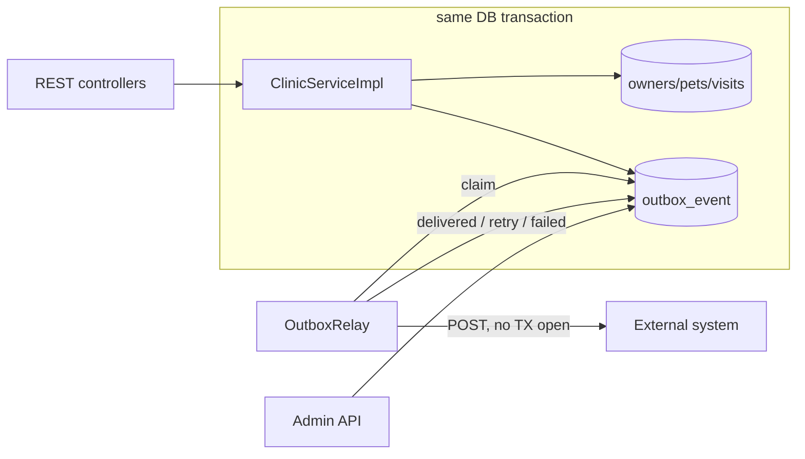

# 02 · Design

Status: proposed. Decisions are in `docs/adr/`; this file shows how they fit together.

## Decisions

| Topic | Decision | ADR |
|---|---|---|
| Integration model | Outbox table in the PetClinic DB + scheduled relay that POSTs events to a webhook | 001 |
| Event format | CloudEvents JSON, full snapshot per record, `v1` types | 002 |
| Delivery | At-least-once, stable event id, ordered per record | 003 |
| Failures | Persisted backoff with jitter, park as FAILED, operator re-queue | 004 |
| Capture point | Explicit calls in `ClinicServiceImpl` | 005 |
| Concurrency | Lease columns + conditional UPDATE | 006 |

## Flow



The request never calls the external system. The only new cost on the request path is one insert per changed record.

## Event table

Added to all four `db/*/schema.sql` files. Timestamps come from the app `Clock` (UTC).

```sql
CREATE TABLE IF NOT EXISTS outbox_event (
  id              BIGINT GENERATED ALWAYS AS IDENTITY PRIMARY KEY, -- also the event seq
  event_id        VARCHAR(36)   NOT NULL UNIQUE,
  subject         VARCHAR(64)   NOT NULL,   -- owner/7
  event_type      VARCHAR(80)   NOT NULL,   -- petclinic.owner.updated.v1
  cause           VARCHAR(64),              -- owner/6 for cascaded deletes
  payload         VARCHAR(4000) NOT NULL,
  status          VARCHAR(16)   NOT NULL,   -- PENDING | DELIVERED | FAILED
  attempts        INTEGER       NOT NULL DEFAULT 0,
  next_attempt_at TIMESTAMP     NOT NULL,
  locked_until    TIMESTAMP,
  locked_by       VARCHAR(64),
  last_error      VARCHAR(1000),
  created_at      TIMESTAMP     NOT NULL,
  delivered_at    TIMESTAMP
);
CREATE INDEX IF NOT EXISTS ix_outbox_due     ON outbox_event (status, next_attempt_at);
CREATE INDEX IF NOT EXISTS ix_outbox_subject ON outbox_event (subject, status, id);
```

MySQL uses `AUTO_INCREMENT` and `DATETIME(6)`. Access is through `JdbcTemplate` so it works under every repository profile.

## Recording

`ChangeRecorder` runs inside the existing service transaction (`Propagation.MANDATORY`), after the business write.

| Method | Events |
|---|---|
| `saveOwner` / `savePet` / `saveVisit` | `created` if `isNew()` before save, else `updated` |
| `deleteVisit` | `visit.deleted` |
| `deletePet` | `visit.deleted` per visit, then `pet.deleted` |
| `deleteOwner` | per pet: its visits, then the pet; then `owner.deleted` |
| `deletePetType` | `visit.deleted` and `pet.deleted` for affected records; no pet type event |

Children are listed before the delete runs and emitted before the parent, with `cause` set to the parent. Pets of a type are found by filtering `findAllPets()`.

## Event format

```json
{
  "specversion": "1.0",
  "id": "6f1c2e0a-8a1b-4c7e-9d0f-2a4b6c8d0b91",
  "source": "/petclinic",
  "type": "petclinic.pet.deleted.v1",
  "subject": "pet/8",
  "time": "2026-11-19T04:12:44.120Z",
  "datacontenttype": "application/json",
  "seq": 1042,
  "cause": "owner/6",
  "data": { "id": 8, "ownerId": 6 }
}
```

| Record | `data` on create/update | `data` on delete |
|---|---|---|
| owner | `id, firstName, lastName, address, city, telephone` | `id` |
| pet | `id, name, birthDate, ownerId, typeId, typeName` | `id, ownerId` |
| visit | `id, petId, date, description` | `id, petId` |

## Relay

Runs every `poll-interval` when publishing is enabled.

1. Pick due events: `PENDING`, `next_attempt_at <= now`, lease free, and no older `PENDING` event for the same subject. Order by `id`, limit `batch-size`.
2. Claim each with `UPDATE ... SET locked_until, locked_by WHERE id = ? AND status = 'PENDING' AND lease free`. Skip if 0 rows.
3. POST it (no DB transaction open).
4. Write the outcome with `WHERE id = ? AND locked_by = me`:
   - 2xx → `DELIVERED`
   - retryable → `attempts + 1`, new `next_attempt_at`, or `FAILED` if out of attempts
   - permanent → `FAILED` with `last_error`

The "no older PENDING event" rule keeps per-record order. A `FAILED` event is not `PENDING`, so it does not block newer ones.

## HTTP publishing

`RestClient`, connect timeout 2 s, read timeout 5 s. Headers: `Content-Type: application/cloudevents+json`, `Idempotency-Key: <event id>`, optional bearer token.

- Retryable: connection/IO errors, timeouts, 408, 425, 429, 5xx (respect `Retry-After`)
- Permanent: 3xx and other 4xx

Backoff: random value between 0 and `min(10 min, 2 s × 2^(attempts-1))`. After 15 attempts the event is parked (about an hour of failures).

## Operator API

Added to `openapi.yml` under tag `integration-admin`. Requires `ADMIN` when security is on.

- `GET /admin/outbox/events?status=FAILED` — list events
- `POST /admin/outbox/events/{id}/retry` — re-queue one (404 if missing, 409 if not FAILED)
- `POST /admin/outbox/events/retry-failed` — re-queue all FAILED

## Observability

- Gauges: pending count, failed count, oldest pending age
- Timer: publish attempts by outcome
- One log line per attempt with event id, subject, attempt, outcome
- Health: `outbox` shows backlog details but always stays `UP`

## Configuration (`petclinic.integration.*`)

| Property | Default |
|---|---|
| `publisher.enabled` | `false` (events are still recorded) |
| `publisher.endpoint` | `http://localhost:8089/events` |
| `publisher.connect-timeout` / `read-timeout` | `2s` / `5s` |
| `relay.poll-interval` / `batch-size` / `lease` | `1s` / `50` / `60s` |
| `retry.initial-delay` / `max-delay` / `max-attempts` | `2s` / `10m` / `15` |
| `retention.delivered` | `7d` |

## Tests

- Recording: one abstract test, run on H2 JDBC, HSQLDB JDBC, JPA and Spring Data JPA
- Relay and HTTP: `@SpringBootTest` + WireMock (standalone jar) + controllable `Clock`, calling `relay.runOnce()` directly
- REST isolation, admin API, metrics: MockMvc
- Unit: backoff, error classification, payload mapping

No Docker or network needed.

## Not in this slice

Kafka adapter, pull change feed, request signing, `findByTypeId` query, time-based retry budget, circuit breaker, Flyway, `SKIP LOCKED`, pet type / vet / specialty events, PII filtering.
